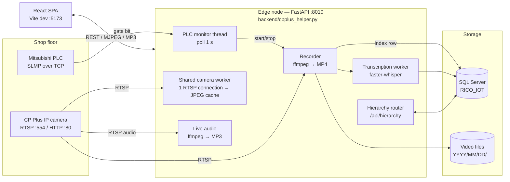

# Camera-WebApp — Machine Event Recording System

**Owner:** Rico Auto Industries — Industrial Automation
**Document version:** 3.0 (rewritten 2026-10-21 against the code on branch `Vikram`, commit `d6d8504`)
**Status:** Running in production on one machine cell. See [§11 Known Issues](#11-known-issues--technical-debt) before extending or exposing the system.

This document describes what the code actually does. Where something is configured outside this repository (production server, PM2 processes), it is marked *outside repo*.

---

## Contents

1. [Purpose](#1-purpose)
2. [Architecture](#2-architecture)
3. [Network & Hardware](#3-network--hardware)
4. [Technology Stack](#4-technology-stack)
5. [Repository Layout](#5-repository-layout)
6. [Core Subsystems](#6-core-subsystems)
7. [Database](#7-database)
8. [REST API Reference](#8-rest-api-reference)
9. [Configuration](#9-configuration)
10. [Running, Deploying & Operating](#10-running-deploying--operating)
11. [Known Issues & Technical Debt](#11-known-issues--technical-debt)
12. [Roadmap](#12-roadmap)

---

## 1. Purpose

On die-casting and machining lines, stoppages happen without a visual record, and root-cause tagging is done from memory. This system:

1. **Watches the machine PLC** (Mitsubishi, SLMP protocol) for a gate/door signal.
2. **Records the camera stream automatically** while the gate is open, and classifies the event as a *minor stoppage* or a *breakdown* by duration.
3. **Indexes every event** in SQL Server with video, duration and an optional speech transcript (faster-whisper).
4. **Lets operators tag a reason** (category + reason + note) against each event.
5. **Shows live video/audio, an event log and downtime analytics** (Pareto, counts, durations) in a React web app.

---

## 2. Architecture



**One process does everything.** `backend/cpplus_helper.py` is the production server. It starts the shared camera worker and the PLC monitor in a background thread during FastAPI startup (`_lifespan`, `cpplus_helper.py:80`) and mounts `hierarchy_api.router`.

> `backend/main.py` and its modules (`config.py`, `camera_service.py`, `stream.py`, `detector.py`, `recorder.py`, `models.py`) are an **earlier prototype**. They run on port 8000 with their own SQLite database, and nothing in production uses them.

---

## 3. Network & Hardware

| Address | Device / service | Notes |
|---|---|---|
| `192.168.117.201` | Mitsubishi PLC | SLMP. Port from settings, with failover over `5000, 5001, 1026, 1027, 5002, 5003` |
| `192.168.119.205` | CP Plus IP camera ("Die Area Camera") | RTSP `554`, HTTP `80`, path `/video/live?channel=1&subtype=0` (main) / `subtype=1` (sub) |
| `192.168.100.46:1433` | Microsoft SQL Server | Database `RICO_IOT` |
| `192.168.100.169` | Windows development node | Backend `:8010`, Vite `:5173`/`:5174` |
| `192.168.100.136` | Linux production node | *outside repo*: PM2 process `camera-backend`; repo path `/home/automation/apps/Camera-WebApp` |

**Current PLC signal** (from `helper_settings.json`): device `X`, address `4A`. Gate open = bit `1` (`gate_open_when=True`); gate closed = bit `0`.

Credentials are **not** documented here. They belong in `camera_app/.env` and in the camera table, and should be rotated (see §11).

---

## 4. Technology Stack

Versions are taken from `camera_app/requirements.txt` and `camera_app/frontend/package.json`.

| Layer | Component | Version |
|---|---|---|
| Runtime | Python | 3.14 (dev venv) |
| API | FastAPI / Uvicorn | 0.136.3 / 0.46.0 |
| Validation | Pydantic | 2.13.4 |
| Video | ffmpeg (external binary), OpenCV | system / 4.13.0.92 |
| Camera discovery | onvif-zeep | 0.2.12 |
| Speech | faster-whisper (model `base`, CPU int8) | 1.2.1 |
| Database driver | pyodbc + Microsoft ODBC Driver 17/18 | 5.3.0 |
| Reports | python-pptx (presentation generator only) | 1.0.2 |
| Frontend | React / React-DOM | ^19.2.3 |
| | TypeScript / Vite / @vitejs/plugin-react | ^5.9.3 / ^7.3.0 / ^5.1.2 |
| | Recharts | ^3.10.1 |
| Database | Microsoft SQL Server | — |
| Process manager | PM2 (Linux) / PowerShell scripts (Windows) | *outside repo* |

---

## 5. Repository Layout

```text
Camera-WebApp/
├── .github/workflows/deploy.yml   # Self-hosted runner: on push to main → pull, pip install, npm build, pm2 restart
├── scripts/
│   ├── start-camera-monitor.ps1   # Windows: start backend (:8010) + Vite dev (:5174) if not running; logs to runtime_logs/
│   ├── restart-camera-live.ps1    # Windows: kill :8010 and restart uvicorn backend.cpplus_helper:app
│   └── RicoCameraMonitorStartup.cmd  # Wrapper for start-camera-monitor.ps1 (for Task Scheduler / Startup)
├── camera_app/
│   ├── .env.example               # Template for camera_app/.env (copy and fill in)
│   ├── helper_settings.json       # Runtime settings written by POST /settings (camera, PLC, storage)
│   ├── requirements.txt
│   ├── backend/
│   │   ├── cpplus_helper.py       # ★ Production server: streaming, PLC, recording, index, transcription, camera proxy
│   │   ├── hierarchy_api.py       # /api/hierarchy: plant → department → line → machine → camera CRUD + camera streams
│   │   ├── db.py                  # SQL Server connection (retry) + PrefixCursor (dev_ table prefix, SQLite→T-SQL rewrite)
│   │   ├── stream_pool.py         # Per-camera frame workers for multi-camera grid
│   │   ├── init_hierarchy_db.py   # Creates/seeds hierarchy tables; adds hierarchy columns to recordings
│   │   ├── migrate_to_sql_server.py  # One-off SQLite → SQL Server migration
│   │   ├── generate_pptx.py       # Builds PROJECT_PRESENTATION.pptx
│   │   ├── rnnoise_models/bd.rnnn # RNNoise model for ffmpeg arnndn audio filter
│   │   └── main.py, config.py, camera_service.py, stream.py,
│   │       detector.py, recorder.py, models.py   # Legacy prototype (unused)
│   ├── frontend/
│   │   ├── src/
│   │   │   ├── App.tsx            # Shell, login, Live page, Saved (event log) page, reason dialog, polling
│   │   │   ├── Dashboard.tsx      # Analytics page (Pareto, KPIs)
│   │   │   ├── HierarchyManager.tsx  # Hierarchy page (plants … cameras)
│   │   │   ├── MultiCamGrid.tsx   # Multi-camera live grid
│   │   │   ├── SettingsHub.tsx, CameraEditModal.tsx
│   │   │   ├── api.ts             # API base URL + typed fetch helpers
│   │   │   └── downtimeData.ts    # Downtime reason taxonomy
│   │   └── vite.config.ts
│   ├── scratch/                   # Ad-hoc verification scripts (not part of the app)
│   ├── read_excel.py, verify_db.py   # One-off utilities
│   └── (ignored) .venv/, model_cache/, recordings/, transcription_tmp/, camera_app.db
├── runtime_logs/                  # (ignored) output of start-camera-monitor.ps1
└── README.md, PROJECT_DOCUMENTATION.md, TECHNICAL_DOCUMENTATION.md, …
```

**Frontend pages** (`type Page` in `App.tsx`): `live`, `saved`, `analytics`, `hierarchy`.

---

## 6. Core Subsystems

### 6.1 Shared camera worker (live video)

`shared_camera_worker` (`cpplus_helper.py:690`) holds **one** ffmpeg RTSP connection per camera key. It decodes to JPEG frames and caches the latest one. Every viewer of `/live.jpg`, `/mjpeg` or `/api/hierarchy/cameras/{id}/mjpeg` reads from that cache, so the camera sees a single connection no matter how many browsers are open.

Tuning (env): `LIVE_PREVIEW_MAX_WIDTH`, `LIVE_PREVIEW_TARGET_FPS`, `LIVE_PREVIEW_JPEG_QUALITY`, `LIVE_PREVIEW_STALE_SECONDS`, `LIVE_PREVIEW_RTSP_PATH`, `LIVE_RTSP_TRANSPORT`.

`GET /live.mp4` is a separate transcoded H.264 stream (`LIVE_VIDEO_*` settings).

### 6.2 Live audio

`GET /api/hierarchy/cameras/{id}/audio.mp3` (and the legacy `/audio.mp3`, `/audio.wav`) starts an ffmpeg process per listener. That process transcodes the camera's 8 kHz µ-law audio to MP3 through `LIVE_AUDIO_FILTER`. The default filter is:

```text
volume=2.2,highpass=f=120:poles=2,lowpass=f=4200:poles=2,alimiter=limit=0.95
```

The UI's audio toggle only **mutes** the `<audio>` element. The stream (and its ffmpeg process) keeps running until the page is closed.

### 6.3 PLC monitor

`plc_monitor_worker` (`cpplus_helper.py:3983`) runs in a thread when `plc_enabled` is true. It starts automatically at startup and can also be started with `POST /plc-monitor/start`.

Each tick (`poll_seconds`, default **1.0 s**, minimum 0.2 s):

1. **Read** the gate bit(s) over SLMP (`read_plc_failover`). If the read fails, it tries the failover ports.
2. **Gate opens** → an event starts as `minor_stoppage` and recording starts (if `capture_video`).
3. **Gate stays open ≥ `max_record_seconds`** (setting; constant default 300 s, currently **120 s** in `helper_settings.json`) → the event becomes a `breakdown`.
   - With `capture_breakdown_video=true`, recording **continues until the gate closes**.
   - Otherwise it stops at the limit.
4. **Gate closes** → recording stops, the event end and duration are written to the index, and the state returns to `running`.

Live state is available at `GET /plc-monitor/status`: machine state, current event, last open/close time, consecutive read failures and the last error.

> ⚠ `max_record_seconds` is the **minor→breakdown threshold**, not a recording length cap. There is no hard maximum recording length (see §11).

### 6.4 Recording

`start_recording_internal` → `record_camera_worker` runs ffmpeg against the camera RTSP URL.

| Setting | Behaviour |
|---|---|
| Video codec (`RECORDING_VIDEO_CODEC`) | Default `copy` (no re-encode). Other codecs use `RECORDING_PRESET`, `RECORDING_CRF`, `RECORDING_BITRATE`, `RECORDING_MAX_WIDTH`, `RECORDING_TARGET_FPS` |
| Audio filter | `RECORDING_AUDIO_FILTER` (speech-cleaning chain; obsolete values fall back to the built-in default) |
| File layout | `<storage_root>/YYYY/MM/DD/<ip-with-dashes>_chNN/cpplus_chNN_YYYYMMDD_HHMMSS_to_HHMMSS.mp4` (e.g. `2026/10/21/192-168-119-205_ch01/…`), plus a `.json` sidecar |
| Storage root | Windows `C:\CPPLUS_RECORDINGS`, Linux `/home/automation/apps/Camera-WebApp/camera_app/recordings` (`DEFAULT_STORAGE_ROOT`), overridable in settings |

Stopping only signals the worker. The worker closes ffmpeg, writes the sidecar metadata, indexes the file in SQL Server, then queues transcription.

### 6.5 Transcription

`transcribe_recording_worker` extracts audio to `transcription_tmp/`, applies `TRANSCRIPTION_AUDIO_FILTER`, and runs faster-whisper. The defaults are model `base`, language `hi`, CPU `int8`, VAD on, and the model cached in `model_cache/`.

Low-confidence output is rejected using these thresholds:
- `TRANSCRIPTION_NO_SPEECH_THRESHOLD`
- `TRANSCRIPTION_MIN_AVG_LOGPROB`
- `TRANSCRIPTION_MIN_REASON_CHARS/WORDS`

The result is stored in `recordings.transcript` / `transcript_status`. If `TRANSCRIPTION_AUTO_REASON_ENABLED=1`, it is also used as the reason.

A custom CLI can replace whisper through `TRANSCRIPTION_COMMAND` (it must print the text to stdout).

### 6.6 Reasons & event log

- **Reason options** are stored per category (`minor_stoppage`, `breakdown`) in `reason_options`. They are seeded from `DEFAULT_REASON_OPTIONS` and extended with `POST /reasons`.
- **`POST /recording-reason`** stores the category, reason, note and submitter against a recording.
- **`POST /recording-index/list`** returns paginated, filterable events. **`/recording-index/stats`** returns KPI totals. **`/recording-index/export.csv|xlsx`** exports them.
- **`GET /recording-file`** serves video with HTTP range support, so the browser can seek.

### 6.7 Hierarchy

`hierarchy_api.py` manages **Plant → Department → Line → Machine → Camera**. Deletes cascade.
- Each machine row carries its PLC config.
- Each camera row carries its connection details.
- New recordings are tagged with `plant_id … camera_id`.

---

## 7. Database

All tables live in SQL Server `RICO_IOT`. When `ENVIRONMENT=development` (the default), `PrefixCursor` in `db.py` rewrites table names to a `dev_` prefix (`DB_TABLE_PREFIX_DEV`). That means **dev and production share one database**, separated only by table names.

`PrefixCursor` also rewrites SQLite-style `LIMIT/OFFSET` and `:named` parameters into T-SQL.

### 7.1 `recordings`
Created on demand by `init_recording_index` (`cpplus_helper.py:1369`). The hierarchy columns are added by `init_hierarchy_db.py`.

| Column | Type | Meaning |
|---|---|---|
| `id` | INT IDENTITY PK | |
| `file_path` | NVARCHAR(450) UNIQUE | Absolute path; `event://…` for event-only rows with no video |
| `file_name`, `metadata_path`, `storage_root` | NVARCHAR | |
| `camera_ip`, `channel` | NVARCHAR, INT | |
| `started_at`, `ended_at` | NVARCHAR (ISO text) | Video start/end |
| `duration_seconds`, `frames`, `file_size` | FLOAT, INT, BIGINT | Video facts |
| `status`, `error` | NVARCHAR | System status (`completed`, `failed`, …); see §11 |
| `source_url`, `recording_engine`, `audio` | NVARCHAR | |
| `event_type` | NVARCHAR | `minor_stoppage`, `breakdown`, `self_capture` |
| `event_started_at`, `event_ended_at`, `event_duration_seconds` | NVARCHAR, FLOAT | Gate-open → gate-close |
| `reason_category`, `reason`, `reason_note`, `reason_submitted_by`, `reason_submitted_at` | NVARCHAR | Operator tagging |
| `transcript`, `manual_transcript`, `transcript_status`, `transcript_error`, `transcribed_at` | NVARCHAR | Speech-to-text |
| `plant_id`, `department_id`, `line_id`, `machine_id`, `camera_id` | INT NULL | Hierarchy link |
| `created_at`, `updated_at` | NVARCHAR | |

Timestamps are stored as **ISO text, not DATETIME**, which matters for range queries.

### 7.2 `reason_options`
`id`, `category`, `reason`, `active`, `created_at`, `updated_at`, with UNIQUE(`category`, `reason`).

### 7.3 Hierarchy tables (`init_hierarchy_db.py`)

| Table | Key columns |
|---|---|
| `cam_plants` | `code` (unique), `name`, `location`, `is_active` |
| `cam_departments` | `plant_id` → plants (CASCADE), `code`, `name` |
| `cam_lines` | `department_id` → departments (CASCADE), `code`, `name` |
| `cam_machines` | `line_id` → lines (CASCADE), `code`, `name`, `plc_enabled`, `plc_host`, `plc_port` (5000), `plc_device` (`X`), `plc_address` (`4A`) |
| `cam_cameras` | `machine_id` → machines (CASCADE), `name`, `camera_ip`, `http_port`, `rtsp_port`, `username`, `password`, `channel`, `rtsp_path`, `sub_rtsp_path` |

---

## 8. REST API Reference

Base URL: `http://<node>:8010`. Interactive docs: `http://<node>:8010/docs`.

> **Authentication is currently bypassed.** Every caller is treated as `superadmin` (see §11).

### 8.1 System & settings
| Method | Path | Purpose |
|---|---|---|
| GET | `/settings` | Current `helper_settings.json` (⚠ includes camera password) |
| POST | `/settings` | Save settings (`HelperSettings`) |
| POST | `/auth/login`, `/auth/elevate` | Login (currently always succeeds) |

### 8.2 PLC
| Method | Path | Purpose |
|---|---|---|
| GET | `/plc-monitor/status` | Monitor and machine state |
| POST | `/plc-monitor/start` | Start the monitor with a `PlcMonitorRequest` |
| POST | `/plc-monitor/stop` | Stop the monitor |
| POST | `/plc-test` | Read the PLC bit once |

### 8.3 Recording
| Method | Path | Purpose |
|---|---|---|
| GET | `/recording/status` | Current/last recording |
| POST | `/recording/start` | Manual start (`event_type`: `minor_stoppage` / `breakdown` / `self_capture`) |
| POST | `/recording/stop` | Stop the current recording |

### 8.4 Event index & reasons
| Method | Path | Body / query |
|---|---|---|
| POST | `/recording-index/list` | `RecordingIndexRequest`: `storage_root`, `start_at`, `end_at`, `event_type`, `shift`, `duration_filter`, `machine`, `page`, `page_size` (default 50) |
| POST | `/recording-index/stats` | Same filters → KPI totals |
| POST | `/recording-index/scan` | Re-index files on disk (⚠ currently broken, §11) |
| GET | `/recording-index/export.csv`, `/export.xlsx` | Same filters as query params |
| GET | `/recording-file?storage_root=&file_path=&download=` | Video with range support |
| GET / POST | `/reasons` | List / add reason options |
| POST | `/recording-reason` | `file_path` or `event_started_at`, `event_type`, `reason`, `note`, `submitted_by`, `status`, `manual_transcript` |

### 8.5 Live media
| Method | Path | Purpose |
|---|---|---|
| GET | `/api/hierarchy/cameras/{id}/live.jpg` | Latest frame for a camera (credentials looked up server-side) |
| GET | `/api/hierarchy/cameras/{id}/mjpeg` | MJPEG stream |
| GET | `/api/hierarchy/cameras/{id}/audio.mp3` | Live audio |
| GET | `/live.jpg`, `/mjpeg`, `/live.mp4`, `/audio.mp3`, `/audio.wav` | Legacy: camera details passed in the query string |
| POST | `/live-frame`, `/stream-urls`, `/verify`, `/camera-diagnostics`, `/recordings`, `/download` | Camera utilities |
| WS | `/rtspoverwebsocket` | Proxy for the camera's own web player |
| GET/POST | `/camera-web/…`, `/cpapi*`, `/{asset_path}` (catch-all) | Reverse proxy to the camera's web UI |

### 8.6 Hierarchy (`/api/hierarchy`)
| Method | Path |
|---|---|
| GET | `/api/hierarchy` (full tree), `/api/hierarchy/cameras?plant_id=&department_id=&line_id=&machine_id=` |
| POST | `/api/hierarchy/test-camera`, `/api/hierarchy/test-plc` |
| POST / PUT / DELETE | `/api/hierarchy/{plants\|departments\|lines\|machines\|cameras}[/{id}]` |

---

## 9. Configuration

There are two sources of configuration:

1. **`camera_app/.env`**, loaded at startup. Copy it from `.env.example`.
   | Group | Variables |
   |---|---|
   | Database | `ENVIRONMENT` (`development`/`production`), `DB_SERVER`, `DB_PORT`, `DB_NAME_DEV`, `DB_NAME_PROD`, `DB_USER`, `DB_PASSWORD`, `DB_ENCRYPT`, `DB_TABLE_PREFIX_DEV` |
   | Binaries | `FFMPEG_PATH`, `FFPROBE_PATH` |
   | Live preview | `LIVE_PREVIEW_*`, `LIVE_VIDEO_*`, `LIVE_RTSP_TRANSPORT`, `LIVE_AUDIO_FILTER` |
   | Recording | `RECORDING_VIDEO_CODEC`, `RECORDING_PRESET`, `RECORDING_CRF`, `RECORDING_BITRATE`, `RECORDING_MAX_WIDTH`, `RECORDING_TARGET_FPS`/`RECORDING_FPS`, `RECORDING_FFMPEG_THREADS`, `RECORDING_AUDIO_FILTER` |
   | Transcription | `TRANSCRIPTION_*` (enabled, model, language, device, compute type, VAD, thresholds, command) |
   | Misc | `HELPER_SETTINGS_PATH`, `HELPER_HOST` |

2. **`camera_app/helper_settings.json`**, read and written by `GET/POST /settings`. It holds the camera (`ip`, ports, `username`, `password`, `channel`, `rtsp_path`), `storage_root`, the PLC (`plc_enabled`, `plc_host`, `plc_port`, `plc_device`, `plc_address`), `capture_video`, `capture_breakdown_video` and `max_record_seconds`.

> **Unused variables in `.env.example`:** `.env.example` lists variables the production backend never reads, for example `PLC_HOST`, `PLC_PORT`, `PLC_GATE_*`, `MAX_GATE_RECORD_SECONDS`, `AUTO_START_PLC_MONITOR`, `CPPLUS_STORAGE_ROOT` and `CPPLUS_HELPER_URL`. PLC and storage settings come from `helper_settings.json`. `CAMERA_*`, `DATABASE_URL` and `RECORDINGS_ROOT` are used only by the legacy `main.py`. Changing those values has no effect on production.

**Frontend:** `VITE_HELPER_URL` sets the API base. If it is unset, the frontend uses `http(s)://<page-host>:8010`. The `/api` proxy in `vite.config.ts` is not used by the app.

---

## 10. Running, Deploying & Operating

### 10.1 Windows (development / single node)

```powershell
# Backend
cd camera_app
python -m venv .venv
.\.venv\Scripts\pip install -r requirements.txt
copy .env.example .env          # then fill in DB and credentials
.\.venv\Scripts\python -m uvicorn backend.cpplus_helper:app --host 0.0.0.0 --port 8010

# Frontend
cd camera_app\frontend
npm ci
npm run dev                     # http://<host>:5173
```

You also need **ffmpeg** (on PATH or `FFMPEG_PATH`) and the **Microsoft ODBC Driver for SQL Server**. On the first transcription, faster-whisper downloads the model into `camera_app/model_cache/`.

Scripts for unattended Windows operation:
- `scripts/RicoCameraMonitorStartup.cmd` → `start-camera-monitor.ps1`. It starts the backend and the Vite dev server on **5174** if they aren't running, and logs to `runtime_logs/`.
- `scripts/restart-camera-live.ps1` restarts only the backend.

### 10.2 Linux production — CI/CD

`.github/workflows/deploy.yml` runs on a **self-hosted runner** on **push to `main`**:

1. `git reset --hard origin/main` in `/home/automation/apps/Camera-WebApp`
2. `pip install -r camera_app/requirements.txt` into `camera_app/.venv`
3. `npm install && npm run build` in `camera_app/frontend`
4. `pm2 restart camera-backend`

The PM2 process definitions are *outside repo*. The built `frontend/dist` is **not served by the backend**, so a separate static server or PM2 process must serve it (reported as port 3000; not defined in this repo).

Work happens on the `Vikram` branch and must be merged to `main` to deploy.

### 10.3 Health checks

```bash
curl http://<node>:8010/recording/status       # backend alive, last recording
curl http://<node>:8010/plc-monitor/status     # running, machine_state, consecutive_read_failures, last_error
curl -X POST -H 'Content-Type: application/json' -d '{}' http://<node>:8010/recording-index/stats   # DB reachable
```

### 10.4 Troubleshooting

| Symptom | Likely cause | Action |
|---|---|---|
| Browser `ERR_CONNECTION_REFUSED :8010` | Backend down or bound to 127.0.0.1 | `pm2 status` / restart; start with `--host 0.0.0.0` |
| API calls hang ~70 s then return 400 | SQL Server unreachable (4 retries × 15 s in `db.py`) | Check `192.168.100.46:1433`, ODBC driver, `DB_ENCRYPT` (Linux ODBC 18 needs `Encrypt=no` + `TrustServerCertificate`) |
| `plc-monitor/status` shows read failures | PLC unreachable or wrong port/device | Ping the PLC; `POST /plc-test`; check `plc_port` and failover ports |
| Recording "running" never ends | PLC read failures keep the gate "open", or indexing failed in the worker | Check `last_error`; `POST /recording/stop`; see §11 |
| Live view frozen | Shared camera worker lost RTSP | Check the camera; restart the backend |
| No live audio | Browser autoplay block | Click Audio ON; the camera microphone must be enabled |
| Video won't seek | Range request not honoured | Fetch it via `/recording-file` (supports HTTP 206) |

---

## 11. Known Issues & Technical Debt

This list comes from a code and live-system review on 2026-10-21. It is ordered by severity.

### Security (fix before exposing beyond the plant LAN)
1. **Auth is disabled.**
   - `auth_session` / `role_from_token` / `require_role` always return `superadmin` (`cpplus_helper.py:1299-1311`), and `App.tsx:4579` hardcodes `authenticated = true`.
   - `/api/hierarchy` has no auth at all.
2. **Hardcoded credentials.**
   - The camera password appears in about 20 places across backend and frontend.
   - The SQL password is the env default in `db.py` and `migrate_to_sql_server.py`.
   - App user passwords are in `AUTH_USERS`.
   - Admin passwords are in `api.ts`.
   - `helper_settings.json` (with a password) is tracked in git.
   - **Rotate all of these** and load them only from `.env`.
3. **Passwords are exposed at runtime.**
   - `GET /settings` and `/api/hierarchy/cameras` return passwords.
   - `/camera-web` injects an auto-login script.
   - Legacy stream URLs carry the password in the query string.
   - The frontend stores settings (with the password) in localStorage.
4. **Path traversal.** `/recording-file` validates against a client-supplied `storage_root`.
5. **SSRF.** Camera IP/port come from the request on `/live.jpg`, `/download` and similar routes.
6. **CORS** `allow_origins=['*']` with credentials.

### Data correctness
7. **"Today" stats are all-time.** Neither the frontend nor the backend applies a default date window, so `/recording-index/stats` sums every record.
8. **Durations are overstated.** Overlapping events are summed in full instead of being clipped to the window.
9. **Duplicate rows.** `stop_recording_internal` waits only 5 s for the worker. When indexing is slower, a second `event://` row is inserted for the same event.
10. **No hard recording cap.** A PLC read failure keeps the gate "open". One recording has run for 18.6 h.
11. **Mixed `status` values.** `status` mixes system values (`completed`) with UI free text (`Pending`).

### Reliability
12. **Re-indexing is broken.** `/recording-index/scan` calls `index_recording_file` without its `record` argument, so it raises TypeError.
13. **State can stick at running.** If indexing raises in the recording worker, `recording_state['running']` stays `True`.
14. **Ineffective lock.** `with threading.Lock():` at `cpplus_helper.py:2136` creates a new lock each call. The shared state dicts are not synchronised.
15. **Blocking proxy.** The async camera proxy routes call blocking `requests`, so a slow camera stalls the event loop.
16. **Heavy per-call initialisation.** `init_recording_index` runs on every call, and its `ALTER TABLE … ADD COLUMN` is not valid T-SQL.
17. **Unchecked API helpers.** The frontend PUT/DELETE helpers in `api.ts` don't check `res.ok`, so failures show as success.

### Structure & tooling
18. **Oversized files.**
    - `cpplus_helper.py` (~4,900 lines) should be split into `api/`, `services/{recording,plc,streaming,transcription}.py` and `db/`.
    - `App.tsx` (~5,200 lines) should be split into `pages/`, `components/`, `hooks/` and `utils/`.
19. **Leftover files.** The legacy prototype (`main.py` …) and `scratch/` scripts are still in the tree. There are four overlapping docs at the root.
20. **No safety net in the toolchain.**
    - There are no automated tests and no linter.
    - `npm run build` doesn't type-check; there is one TS error in `HierarchyManager.tsx:242`.
    - Build tools sit in `dependencies`.
    - CI uses `npm install` instead of `npm ci`.

---

## 12. Roadmap

Proposed, not scheduled.

**Stabilise (do first):** §11 items 1–17, plus a hard recording cap with a PLC-failure timeout, and a `/health` endpoint.

**Scale:**
- Disk retention, e.g. purge untagged clips older than 30 days or when the disk is over 85 % full.
- One PLC monitor per machine from `cam_machines`.
- Production DB cutover (`ENVIRONMENT=production`, unprefixed tables, in a separate database from dev).

**Operate:**
- Breakdown alerts by e-mail or WhatsApp.
- Operator badge login.
- End-of-shift downtime reports.

**Extend:**
- Vision-based safety checks (PPE, gate-open hazard).
- SAP PM work-order creation from confirmed breakdowns.
- Cycle-time drift detection for predictive maintenance.
